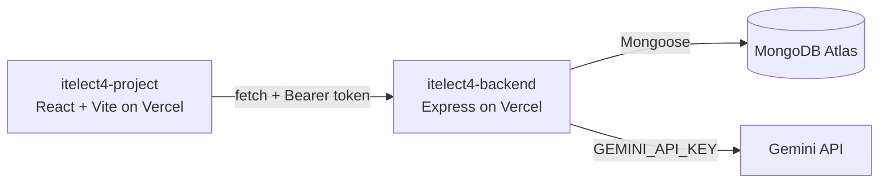

# itelect4-project

Vite + React + TypeScript demo for ITELECT4.

## Live

- **Frontend:** https://itelect4-project-three.vercel.app
- **Backend:** https://itelect4-backend-nine.vercel.app

## Architecture

## Tests

`npm test` runs the three Vitest suites (a component, a hook, and a
validated form) in jsdom. GitHub Actions runs them, plus lint and the
build, on every push (`.github/workflows/ci.yml`).

## Project structure

- `index.html` — Vite HTML entry point
- `package.json` — project dependencies and scripts
- `tsconfig.json` — TypeScript configuration
- `vite.config.ts` — Vite configuration
- `src/main.tsx` — React entry point
- `src/App.tsx` — main component
- `src/gt1-foundations.ts` — TypeScript foundation examples
- `src/types/index.ts` — shared interfaces and props
- `src/components/` — typed React components
