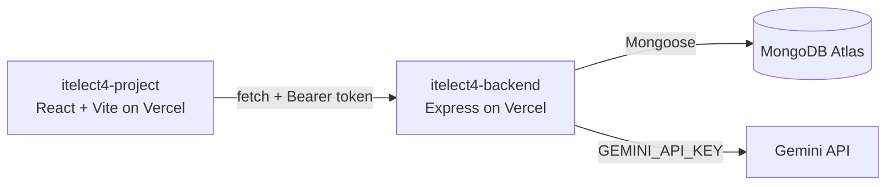

# itelect4-project

[](https://github.com/JBenjo/itelect4-project/actions/workflows/ci.yml)

Vite + React + TypeScript demo for ITELECT4.

## Live

- **Frontend:** https://itelect4-project-three.vercel.app
- **Backend:** https://itelect4-backend-nine.vercel.app

## Architecture



## Run locally

```bash
git clone https://github.com/JBenjo/itelect4-project.git
cd itelect4-project
npm install
cp .env.example .env   # then fill in VITE_API_URL (backend address, no /api, no trailing slash)
npm run dev            # app on http://localhost:5173
```

- `npm run build` — type-check and build the production bundle.
- `npm test` — the three Vitest suites (component, hook, form).

## Tests

`npm test` runs the three Vitest suites (a component, a hook, and a
validated form) in jsdom. GitHub Actions runs them, plus lint and the
build, on every push (`.github/workflows/ci.yml`).

## AI-use disclosure

This repository was built with the help of an AI coding assistant, used
across Sessions 1 to 12 for scaffolding, explanations and debugging.
Every line was reviewed before being committed, and the author can
explain how it works. The AI Review page calls this app's own backend,
which is part of the ITELECT4 coursework itself.

## Project structure

- `index.html` — Vite HTML entry point
- `package.json` — project dependencies and scripts
- `tsconfig.json` — TypeScript configuration
- `vite.config.ts` — Vite configuration
- `src/main.tsx` — React entry point
- `src/App.tsx` — main component
- `src/gt1-foundations.ts` — TypeScript foundation examples
- `src/types/index.ts` — shared interfaces and props
- `src/components/` — typed React components
